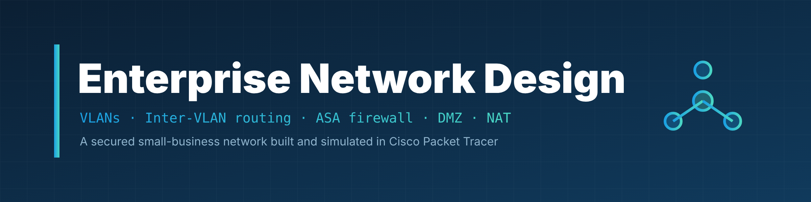
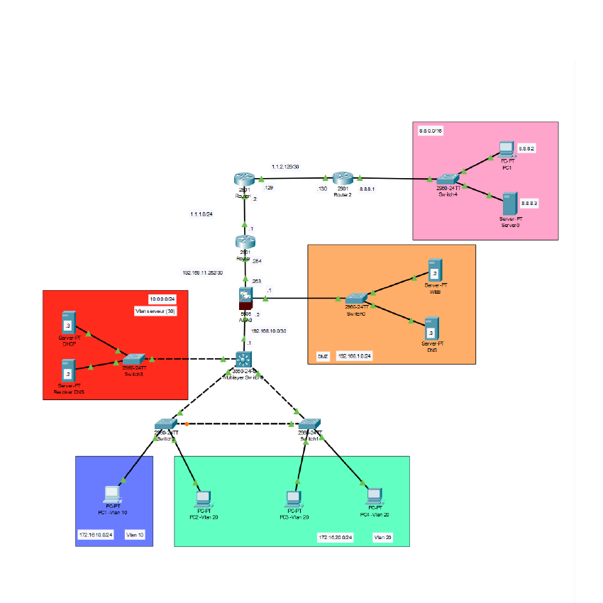

  

  <b>A reliable and secured network for a small business, designed and simulated in Cisco Packet Tracer — VLAN segmentation, inter-VLAN routing on a Layer-3 switch, an ASA firewall, a DMZ, and NAT interconnection with an ISP.</b>

  
  
  
  
  

---

## 🎯 Overview

This project designs and implements a complete network for a small professional structure (PME), following enterprise good practices. The goal is an infrastructure that is **reliable, segmented, and secured**, built entirely in **Cisco Packet Tracer**.

Key building blocks:

- **VLANs** to segment the company's services (HR, Engineering, internal servers)
- A **Layer-3 switch (MLS)** for inter-VLAN routing
- A **Cisco ASA firewall** to control inbound and outbound traffic
- A **DMZ** hosting a public web server and a DNS server
- **DHCP / DNS** services
- **NAT** interconnection with an Internet Service Provider (FAI) and an external test network

> 🎓 University project — **SAÉ 2.1 "Construire un réseau informatique pour une petite structure"**, BUT Networks &amp; Telecommunications, IUT Nice Côte d'Azur, 2024–2025.

## 🗺️ Network topology

  

The network is organized in layers: the internal VLANs connect through access switches to a central Layer-3 switch, which routes between VLANs and connects to the **ASA firewall**. The ASA separates the **inside** (company), the **DMZ** (public servers), and the **outside** (ISP). The ISP router then connects to the Internet and to an external test network used to validate access to the DMZ.

## 📋 Addressing plan

### Internal VLANs (private networks)
| VLAN | Role | Subnet | Gateway (MLS) |
|---|---|---|---|
| VLAN 10 | HR (RH) | 172.16.10.0/24 | 172.16.10.1 |
| VLAN 20 | Engineering | 172.16.20.0/24 | 172.16.20.1 |
| VLAN 30 | Internal servers | 10.0.0.0/24 | 10.0.0.1 |

### Interconnections
| Link | Interface | IP address | Mask |
|---|---|---|---|
| MLS ↔ ASA | MLS side | 192.168.10.1 | /30 |
| MLS ↔ ASA | ASA inside | 192.168.10.2 | /30 |
| ASA ↔ ISP | ASA outside | 192.168.11.253 | /30 |
| ASA ↔ ISP | ISP router (client) | 192.168.11.254 | /30 |
| ISP ↔ Internet | ISP router | 1.1.1.1 | /24 |
| ISP ↔ Internet | Internet side | 1.1.1.2 | /24 |
| Internet ↔ Test net | Internet side | 1.1.2.129 | /30 |
| Internet ↔ Test net | Test router | 1.1.2.130 | /30 |

### DMZ
| Device | IP address | Mask |
|---|---|---|
| Web server (DMZ) | 192.168.1.2 | /24 |
| DNS server | 192.168.1.3 | /24 |
| ASA (DMZ interface) | 192.168.1.1 | /24 |

### External test network (8.8.0.0/16)
| Device | IP address | Mask | Purpose |
|---|---|---|---|
| Test client | 8.8.8.2 | /16 | Test access to the DMZ site |
| Test web server | 8.8.8.3 | /16 | Test access from the company |
| Test router | 8.8.8.1 | /16 | Gateway |

## 🔧 What is configured

1. **Core of the network** — VLANs, access/trunk ports, spanning-tree (PVST) priorities, and inter-VLAN routing on the Layer-3 switch.
2. **ASA + DHCP** — the ASA firewall with its inside/outside/DMZ interfaces and DHCP service for the internal VLANs.
3. **DMZ + ISP router** — the public web and DNS servers in the DMZ, with the ISP (FAI) router.
4. **Public network + NAT** — Internet interconnection and NAT so the internal network reaches the outside and the DMZ server is reachable from outside.

Full command-by-command configuration and connectivity tests are in the [report](rapport.pdf).

## 🚀 How to open

1. Install **Cisco Packet Tracer** (version 8.x recommended).
2. Open **[`sae21-network.pkt`](sae21-network.pkt)**.
3. Use the command-line interface of each device to inspect the configuration, or run the connectivity tests described in the report (ping between VLANs, access to the DMZ web server from the test network, etc.).

## 👥 Team — SAÉ 2.1

Project by **Mohammed Al-Abri** and Rayan Zoubir.
Supervisors: Michael Lance, Guillaume Urvoy-Keller.

## 📚 Documentation

- 📄 [Full technical report](rapport.pdf) — topology, addressing plan, step-by-step configuration, and validation tests.

Addresses such as 1.1.1.1 and 8.8.8.x are used only inside this isolated Packet Tracer simulation for teaching purposes.
